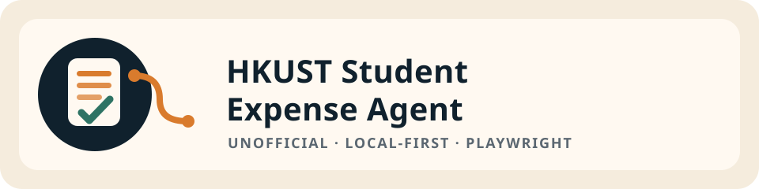

<p align="center">
  
</p>

# HKUST Student Expense Agent

[](LICENSE)
[](#safety-model)
[](https://playwright.dev/)

Chinese version: [README.zh-CN.md](README.zh-CN.md)

Unofficial local-first browser automation for the HKUST `Expense Claim for Student Form`.

This project helps students turn a repetitive reimbursement workflow into a reproducible local toolchain:

- capture a real logged-in form snapshot
- map stable fields from the live DOM
- fill claims from an explicit local config
- stop for human review before any submission

## Status

Experimental, but already usable for local browser-assisted drafting.

## Branch Guide

- `main`: stable local browser automation for snapshot/check/fill workflows
- `v0.2-llm-foundation`: experimental branch for the LLM-assisted receipt extraction workflow

If you specifically want the current LLM version, switch to `v0.2-llm-foundation`.

Current scope:

- HKUST `Expense Claim for Student Form`
- manual login only
- local browser session reuse
- config-driven filling with attachment upload
- no automatic submission by default

## Why This Project Exists

HKUST reimbursement eForms are repetitive enough to automate, but dynamic enough that generic autofill tools are brittle. The target form uses generated DOM ids and custom YZSoft controls, so stability comes from inspecting the real page structure and relying on stable field bindings.

This repository packages that approach into a small CLI workflow that stays inspectable, local, and easy to modify.

## Key Features

- `snapshot` mode to inspect the real logged-in form and save a local DOM artifact
- `fill` mode to apply a structured claim config against the live form
- support for stable `dataBind` locators instead of fragile generated ids
- file upload support for receipts and supporting documents
- local config validation before opening the browser
- explicit review step before any real submission action

## Safety Model

This repository is intentionally conservative.

- You log in with your own HKUST account in a real browser window.
- The tool reuses only your local browser profile under `.auth/`.
- It does not ask for or store your password in code or chat.
- It does not bypass SSO, MFA, captcha, or access control.
- It should not be run as a hosted service for other people's accounts.
- Optional submission requires a separate submit step and typing `SUBMIT` to confirm.

## Quick Start

```bash
npm install
npx playwright install chromium
cp config/claim.sample.json config/claim.local.json
```

Capture a real logged-in snapshot first:

```bash
npm run snapshot
```

Then validate and fill:

```bash
npm run check
npm run fill
```

Replace the sample attachment path with a real local file before checking or
filling. `fill` now runs the same validation as `check` before opening the
browser. Invalid actions, locators, wait durations, and missing or placeholder
attachments stop the run before any fields are changed.

To check a different config, run `npm run check -- config/my-claim.local.json`.
Relative config paths are resolved from the repository root. Relative attachment
paths are resolved from the directory where you run the command; absolute paths
work from any directory. `locator.nth` is zero-based and works with every locator
kind, allowing you to target repeated expense rows explicitly.

For optional submission, define a separate `submitStep` with `action: "click"`
and enable `submit: true` or pass `--submit`. You must still type `SUBMIT` in the
terminal. Ordinary `steps` execute as configured, including any clicks, so keep
the final submit button exclusively in `submitStep`.

## How It Works

1. `snapshot`
   Opens the target form, waits for manual login if needed, and saves a local snapshot of frames, controls, and nearby field text.

2. `check`
   Verifies your local config shape and attachment paths before browser automation starts.

3. `fill`
   Reopens the form with your local session, applies the configured steps, uploads files, and pauses for review.

## Repository Layout

- `scripts/eform-agent.mjs`
  The main snapshot and fill runner.
- `scripts/check-config.mjs`
  The CLI for the shared config validator in `scripts/lib/config.mjs`.
- `scripts/lib/automation.mjs`
  Reusable browser actions and field locator handling.
- `config/claim.sample.json`
  A safe sample config with fake values.
- `docs/PUBLISHING.md`
  Checklist for publishing forks without leaking sensitive files.
- `docs/CLI_ANYTHING.md`
  Notes for wrapping this repo into a broader agent workflow.

## Files You Should Never Commit

- `.auth/`
- `artifacts/`
- `config/claim.local.json`
- real receipts, invoices, screenshots, bank details, or boarding passes
- logged-in DOM snapshots from real claims

## Who This Is For

- HKUST students who want a local-first reimbursement helper
- contributors who prefer transparent browser automation over opaque SaaS flows
- people building reusable agent workflows around campus admin tasks

## Non-Goals

- pretending to be an official HKUST product
- collecting or managing user credentials
- building a shared hosted bot that logs in on behalf of users
- hiding the fact that final review should remain human

## Roadmap

- more robust field discovery helpers
- reusable templates for common claim patterns
- safer redaction tooling for sharing snapshots
- optional packaging into broader agent ecosystems

## Development and Tests

Use Node.js 22 and the committed lockfile for reproducible development:

```bash
npm ci
npx playwright install chromium
npm test
```

`npm run test:config` checks validation without launching a browser.
`npm run test:browser` exercises field selection and actions against synthetic
local HTML. GitHub Actions runs both suites on Linux. These tests do not use an
HKUST account, real receipts, or the live eForm; manual testing is still needed
for SSO and YZSoft-specific interactions.

## Disclaimer

This is an unofficial community project. Use it responsibly and only for forms and accounts you are authorized to access.

## License

MIT
